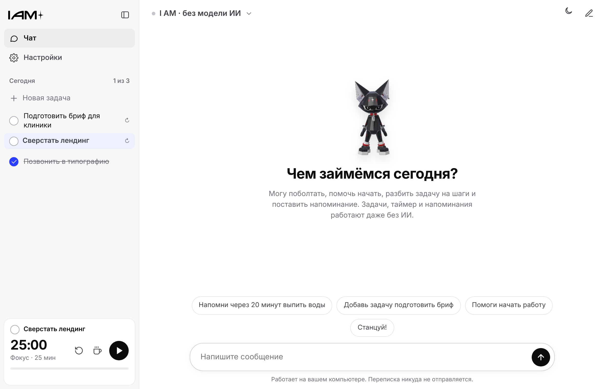

# I AM — помощник студии

Помощник для дизайн-студии I AM: маскот на рабочем столе, задачи на день, таймер фокуса, напоминания о воде, отдыхе для глаз, перерывах и зарядке, а также чат с ИИ. ИИ работает **прямо на компьютере**: без подписок, ключей и облака. Интернет нужен только один раз — чтобы скачать модель.

Платформы: **macOS 12+ (Apple Silicon M1–M5)** и **Windows 10/11 x64**.



---

## Установка

### macOS
1. Скачайте `I AM_0.1.0_aarch64.dmg` — со страницы **Releases** или из последней сборки во вкладке **Actions** (раздел *Artifacts*).
2. Откройте `.dmg` и перетащите **I AM** в «Программы».
3. При первом запуске macOS предупредит, что разработчик не подтверждён: у приложения пока нет платной подписи Apple.
   - Нажмите на значок правой кнопкой → **Открыть** → **Открыть**.
   - Или откройте «Системные настройки → Конфиденциальность и безопасность» и нажмите **«Всё равно открыть»**.
   Это нужно сделать один раз.

### Windows
1. Скачайте `I AM_0.1.0_x64-setup.exe`.
2. Запустите его. Если появится синее окно SmartScreen, нажмите **«Подробнее» → «Выполнить в любом случае»** (у приложения пока нет платной подписи).
3. Права администратора не нужны: приложение ставится в профиль пользователя.

### Первый запуск
Откроется мастер из четырёх шагов: имя → выбор модели ИИ (с размером загрузки, местом на диске и памятью) → автозапуск → рабочие часы и напоминания. Модель скачивается в фоне. Задачи, таймер и напоминания работают сразу, без модели.

---

## Как пользоваться

**Маскот** стоит в правом нижнем углу экрана.
- Перетаскивайте мышью.
- Одиночный щелчок — реакция. Четыре щелчка подряд — фокус.
- Двойной щелчок — рабочее окно.
- При наведении появляется панель: чат, таймер, танец, «подбодри», «Не беспокоить», настройки, скрыть.

Скрытый маскот живёт в трее Windows или строке меню macOS. Левый клик по значку возвращает его, правый открывает меню.

**Рабочее окно:** слева задачи на сегодня и таймер, по центру чат.

Команды в чате работают **без ИИ**:

| Пример | Что произойдёт |
|---|---|
| `напомни через 20 минут выпить воды` | напоминание сохраняется и отображается в списке |
| `напомни в 15:30 отправить макет` / `завтра в 10 утра …` | разовое напоминание на время |
| `добавь задачу подготовить бриф` | новая задача |
| `я сделал бриф` | задача отмечается выполненной, маскот хвалит |
| `запусти таймер на 50 минут` / `пауза` / `стоп таймер` / `перерыв` | таймер |
| `не беспокой 2 часа` / `можно беспокоить` | режим «Не беспокоить» |
| `разбей задачу … на шаги` | ИИ предлагает шаги, вы подтверждаете |
| `запомни, что я арт-директор` | сведение о вас (видно и удаляется в настройках) |
| `станцуй` | маскот танцует |

Если ИИ в ответе **предлагает** задачу или напоминание, под ответом появляется карточка с кнопкой «Подтвердить». Данные меняются только после нажатия, и только тогда появляется отметка «✓ Сохранено». Если модель пишет «я поставил напоминание», а ничего не сохранено, приложение убирает эту фразу и показывает предупреждение.

---

## Модели ИИ

Все три — **Apache 2.0**: бесплатны, разрешено коммерческое использование и распространение. Скачиваются в формате GGUF с Hugging Face. Работают через движок **llama.cpp** (MIT), с ускорением Metal на Mac и Vulkan на Windows; если видеоускорение не запустилось, приложение само переключается на процессор.

| Уровень | Модель | Загрузка | Память при общении* | Для кого |
|---|---|---|---|---|
| Лёгкая | Qwen3.5 2B (Q4_K_M) | 1,2 ГБ | ≈ 2 ГБ | MacBook Air с 8 ГБ; самые быстрые ответы, русский попроще |
| Сбалансированная | Gemma 4 E2B (Q4_K_M) | 2,9 ГБ | ≈ 3,5 ГБ | рекомендуем для 16 ГБ, работает и на 8 ГБ; заметно лучше по-русски |
| Качественная | Gemma 4 E4B (Q4_K_M) | 4,6 ГБ | ≈ 6 ГБ | только для 16 ГБ и больше |

\* Ориентировочно, при контексте 4K. Точное значение приложение показывает в «Настройки → Система».

Важно: это небольшие локальные модели. До больших облачных ассистентов они не дотягивают: годятся для поддержки, коротких советов, черновиков и разбивки задач, но могут ошибаться в фактах.

- **Модель не загружается при старте компьютера.** Она поднимается в память при первом сообщении в чате; это занимает 10–40 секунд.
- **Выгрузка при простое.** Через 10 минут без сообщений модель выгружается из памяти (интервал меняется в настройках, можно выключить). Выгрузить вручную можно кнопкой «Выгрузить из памяти».
- **Удалить или заменить модель** можно в «Настройки → Модель ИИ».
- **Загрузка докачивается** после обрыва; файл проверяется по размеру и заголовку формата GGUF.

---

## Размер и ресурсы

Замерено на сборках этой версии в GitHub Actions: macOS 14 на виртуальном Apple M1 (7 ГБ ОЗУ) и Windows Server 2025 (4 ядра, 16 ГБ).

| Что | macOS | Windows |
|---|---|---|
| Установщик | 28,8 МБ (.dmg) | 19,0 МБ (-setup.exe) |
| Приложение: оболочка, интерфейс, маскот | **7,2 МБ** | **7,6 МБ** |
| — в том числе ресурсы маскота | 2,3 МБ | 2,3 МБ |
| Движок ИИ llama.cpp (входит в установку) | 69 МБ (Metal) | 89 МБ (Vulkan + варианты под разные процессоры) |
| Модель ИИ (скачивается отдельно) | 1,2 / 2,9 / 4,6 ГБ | 1,2 / 2,9 / 4,6 ГБ |
| ОЗУ в ожидании: только маскот, модель не загружена | ≈ 175 МБ (процесс 87 МБ + WebKit ≈ 90 МБ) | ≈ 320 МБ (процесс 31 МБ + процессы WebView2)\* |
| ОЗУ с открытым рабочим окном | ≈ 260–330 МБ | ≈ 430–470 МБ\* |
| ОЗУ при общении: + процесс модели | Qwen3.5 2B ≈ 2,9 ГБ · Gemma 4 E2B ≈ 3,0 ГБ | Qwen3.5 2B ≈ 2,0 ГБ |

\* На Windows суммируется рабочий набор всех процессов WebView2. Часть этой памяти общая с Microsoft Edge и другими приложениями на WebView2, поэтому реальная добавка меньше.

Скорость ответа на процессоре: Qwen3.5 2B — первое слово через ~1 с, около 65 символов в секунду; Gemma 4 E2B на Mac — около 90 символов в секунду. На ноутбуке с i5 скорость будет того же порядка; с видеоускорением на Apple Silicon — выше.

Почему приложение лёгкое:
- **Оболочка Tauri** использует системный WebView (WebKit на macOS, WebView2 на Windows) и не тащит с собой Chromium, как Electron. Electron-приложение начинается от ~90 МБ и 150+ МБ ОЗУ.
- **Рабочее окно создаётся по требованию** и уничтожается при закрытии. В фоне живёт только маленькое окно маскота.
- **Маскот — заранее отрисованные кадры**, а не 3D в реальном времени (сравнение ниже). Когда маскот скрыт, отрисовка полностью останавливается.
- **Модель — отдельный процесс** llama.cpp, который запускается только для чата и завершается при простое.

---

## Маскот

**Скелета и анимаций в исходной модели нет** (в `.blend` нет объектов armature и action). Зато персонаж собран из отдельных частей: туловище с головой, руки с кистями, ноги, ошейник с жетоном, серьга. Поэтому без доработки модели доступны:
- руки: опустить из Т-позы, махать, тянуться вверх, разводить, подносить к «подбородку»;
- ноги: шагать, подпрыгивать, расставлять;
- корпус: наклоны, повороты, приседание, растяжение и сжатие, прыжки, разворот на 360°;
- голова: кивок, наклон, поворот. Шея плавно смешивает движение головы и туловища.

Без подготовки модели **нельзя**: двигать уши и хвост, моргать, менять выражение лица. Они вшиты в общий меш и текстуру. Для этого нужен риг (скелет) в Blender.

Состояния: ожидание, приветствие, фокус, размышление (пока ИИ отвечает), радость, напоминание о перерыве (потягивается), зарядка («звёздочка»), танец, дурачество (кульбит с разворотом).

### 3D в реальном времени или готовые кадры

| | 3D (WebGL) в реальном времени | Готовые кадры (выбрано) |
|---|---|---|
| Ресурсы | модель 2,6 МБ + 3D-библиотека ~0,6 МБ | 2,3 МБ |
| Нагрузка* | ~65 % одного ядра при 30 кадрах/с (программный рендер) | ~1 % ядра при 12 кадрах/с |
| GPU | работает постоянно, держит батарею | не нужен |
| Внешний вид | зависит от видеокарты и драйвера | одинаковый везде, сглаживание при отрисовке |

\* Замерено в Chromium в этой среде без видеокарты. С настоящим GPU 3D дешевле, но всё равно нагружает систему постоянно.

**Исходная модель не изменялась.** Чтобы собрать кадры, `.blend` разобран напрямую, без Blender. Скрипты лежат в `tools/mascot/`: экспорт в `tools/mascot/mascot.glb` (оптимизированная копия с текстурой 2K), запекание и упаковка кадров. Анимации задаются в `tools/mascot/anims.py`. Пересобрать кадры:
```bash
python3 tools/mascot/export_glb.py "модель.blend" work/mascot.glb 2048   # + mascot.bin/json/_tex.jpg
cp work/mascot.{bin,json} work/mascot_tex.jpg tools/mascot/
python3 tools/mascot/bake.py work/frames && python3 tools/mascot/pack.py work/frames src/assets/mascot 360
```
(нужны Python 3, Pillow, numpy и Playwright с Chromium)

---

## Что проверено

Автоматически при каждой сборке: на macOS и Windows приложение запускается в режиме самопроверки (`--selftest`), и результаты публикуются в ветках `ci-results-macos-14` и `ci-results-windows-latest` (отчёты JSON и скриншоты экрана).

| Проверка | macOS | Windows |
|---|---|---|
| Установка | .app из .dmg | тихая установка `-setup.exe /S` без прав администратора |
| Прозрачный маскот поверх рабочего стола, значок в трее / строке меню | ✓ (скриншоты) | ✓ (скриншоты) |
| Рабочее окно (чат, задачи, таймер) | ✓ | ✓ |
| Задачи сохраняются после перезапуска | ✓ | ✓ |
| Автозапуск: включение и выключение | ✓ | ✓ |
| Системное уведомление | ✓ | ✓ |
| Напоминание срабатывает; в «Не беспокоить» — ждёт | ✓ | ✓ |
| Модель загружается, отвечает по-русски, останавливается кнопкой «Стоп», выгружается | ✓ на процессоре | ✓ |
| Чат при **запрещённом брандмауэром** выходе в интернет (разрешён только 127.0.0.1) | — | ✓ |
| Сквозной тест интерфейса в Chromium (25 проверок) и тесты логики (16) | ✓ | ✓ |

Что не удалось проверить автоматически:
- **Видеоускорение Metal на настоящем Apple Silicon.** У GitHub видеокарта виртуальная, и Metal выдаёт там мусор вместо текста. На процессоре всё работает. Приложение распознаёт повреждённый ответ, само переключается на процессор и повторяет ответ. На реальном Mac с M1–M5 Metal должен работать штатно: это основной режим llama.cpp.
- **Vulkan на Windows с видеокартой.** На сервере GitHub видеокарты нет, поэтому проверен только автоматический переход на процессор.
- **Перетаскивание маскота мышью и щелчки по нему** проверены в браузерном тесте, на настоящих ОС — только отображение.

## Приватность
- Переписка, задачи, напоминания и сведения о пользователе хранятся только на компьютере, в JSON-файлах в папке данных приложения:
  - macOS: `~/Library/Application Support/studio.iam.assistant/`
  - Windows: `%APPDATA%\studio.iam.assistant\`
- В сеть уходит только скачивание модели с huggingface.co, и только по нажатию кнопки. Модель общается с приложением по адресу 127.0.0.1.
- Экран, камера, микрофон и другие приложения не используются.
- В настройках можно очистить историю чата, отключить её сохранение и стереть сведения о себе.

---

## Сборка из исходников

Сборка воспроизводимая: GitHub Actions (`.github/workflows/build.yml`) на каждый push собирает `.dmg` для macOS и `.exe` для Windows. Для релиза поставьте тег `v0.1.0`, и файлы появятся в Releases.

Локально (macOS или Windows):
```bash
# нужны Node.js 20+, Rust (rustup), на macOS — Xcode Command Line Tools
npm install
npm run fonts
bash scripts/fetch-llama.sh          # Windows: pwsh -File scripts/fetch-llama.ps1
npx tauri build
```
Тесты логики (напоминания, таймер, команды, защита от ложных «поставил напоминание»): `npm test`.
Интерфейс можно открыть в браузере без сборки: `python3 -m http.server 8080 -d src`, затем `python3 tests/e2e/mock_llm.py` и `python3 tests/e2e/flow.py` (сквозной тест в Chromium).

### Технологии
- **Tauri 2** (Rust) — окна, прозрачность, трей и строка меню, автозапуск, уведомления, хранение, управление моделью.
- Интерфейс — HTML/CSS/JS без фреймворков и без сборщика.
- **llama.cpp** (`llama-server`) — локальная модель, OpenAI-совместимый API только на 127.0.0.1.
- Шрифт Montserrat (SIL OFL), встроен в приложение.

---

## Подпись и распространение

Бесплатное локальное общение от этого **не зависит**: приложение работает и без подписи, но при первом запуске система покажет предупреждение.

| Что | Зачем | Стоимость |
|---|---|---|
| Apple Developer Program | подпись и нотаризация: macOS открывает приложение без предупреждения | 99 $ в год |
| Сертификат подписи кода для Windows (OV) или Azure Trusted Signing | убирает или смягчает предупреждение SmartScreen | ~ 10 $ в месяц (Azure) или 200–400 $ в год (OV) |
| GitHub Actions | сборка | бесплатно для публичного репозитория; для приватного — бесплатные минуты в пределах лимита (минуты macOS считаются с множителем) |
| Хостинг установщиков | GitHub Releases | бесплатно |

Модели скачиваются напрямую с Hugging Face, поэтому хранить их у себя не нужно.
